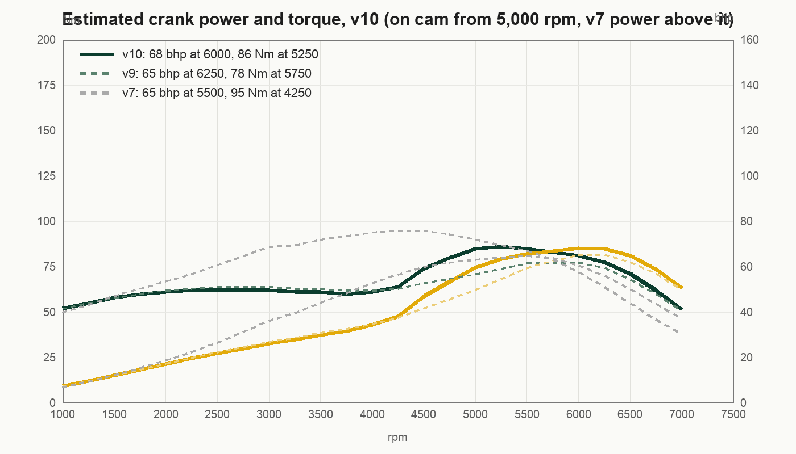

# Gio's 2013 Lotus Seven


A 2013 Birkin S3 Lotus Seven replica, British Racing Green with a yellow nose: Ford Kent crossflow, 711M block bored from 1600 to
1700, gas-flowed head, performance cam, low compression pistons, twin side-draught carbs, wrapped manifolds, 4-speed, live axle, right hand drive,
plated G-SEVEN in the sim. This repo is its twin for Assetto Corsa, built as a re-tune of Ben O'Bro and
JackCY's **Caterham Super7 1700 Super Sprint RHD** mod (v1.52, physics 2.9) from RaceDepartment.

The source tree holds only what was changed or added; `build.py` assembles the full car from the original mod's 7z,
and the releases carry the built zip.

| | |
|---|---|
|  |  |

## Download

The built car is attached to the [latest release](https://github.com/gminator/gios-2013-lotus-seven/releases/latest):
download `bo_birkin_s3_1700_kent.zip` and drag it into Content Manager. It installs as its own car and leaves the
stock Caterham alone. That zip contains the base mod's model, sounds and textures by Ben O'Bro and JackCY.

## Build it yourself

```
python3 build.py ~/Downloads/bo_caterham_1700-v1.52.7z
```

Python 3 with numpy, and `bsdtar` (on macOS by default). Output: `build/bo_birkin_s3_1700_kent/` and a zip to drag into Content
Manager.

## What is different from the stock mod

| Area | Change |
|---|---|
| Gearbox | 4-speed, 2.55 / 1.75 / 1.40 / 1.10, final 3.92, open diff. Evenly spaced for an engine that only comes on at 5,000 rpm (18 Oct 2026, after driving it): a shift at 6,500 rpm lands near 4,460 (1st to 2nd), 5,200 (2nd to 3rd) and 5,100 (3rd to 4th). The stock-like 3.65 / 1.60 gave a dead 1st to 2nd shift (about 2,900 rpm) and a 2nd to 3rd that dropped the revs only 12 percent, which felt like anti-lag. 1st tops out near 72 km/h, 2nd 104, 3rd 130 at 6,500 rpm |
| Engine | 711M 1700 Kent, gas-flowed head, performance cam, low compression: about 68 bhp (51 kW) at 6,000 rpm, 86 Nm at 5,250, 6,800 limiter (v10: weak below about 4,500 rpm, on cam from 5,000, in his words 5,000 rpm is where things start to happen) |
| Mass | 650 kg with driver |
| Rear suspension | Softer springs, less travel before the bump stops (the real car bottoms out) |
| Skin | `00_british_racing_green`: BRG with an aluminium bonnet, yellow grille lip, black 7 grille, silver rims, side vents at the front of each panel, a little below the bonnet seam and clear of the exhaust port, crossed flags with G. ADONIS set back behind them on the sides, G-SEVEN plates |
| Exhaust | Remodelled to his: wrapped elbow out of the side panel, 90 mm silencer in a black expanded-metal half-shell guard (outer side only, 106 mm) with three bands and closed end rings, 52 mm dull-stainless tailpipe out of the guard end that bends outward ahead of the rear wheel with a slight droop, mouth pointing out to the side; the silencer sits just under the body line (`tools/exhaust_geom.py`, texture from `tools/exhaust_texture.py`, written into the kn5 by the build). v12 fixed the open guard end that read as a hole, the tailpipe that swept sideways, and the silver mesh and white pipe; v13 slimmed the whole assembly (it was about a third of the tyre height, his is about a fifth) and made the guard a half shell; v14 turned the tip outward and raised the silencer, which hung too low; v15 made the elbow out of the panel one smooth curve |
| Seats and badges | The Caterham seat patch, belt label and Super 7 roundel in the mod's `tex_misc.dds` replaced with LOTUS 7 items in orange stitching |
| Dash and trim | White-faced VDO dials, speedo in km/h (the mod's was MPH), patched into the kn5; wooden dash, flat body-colour rear deck (the canvas tonneau and its press studs removed) with a wooden luggage rack on chrome rails (`tools/rack_geom.py`), polished screen frame and black headlight housings, all as materials and meshes written into the kn5 |

## The engine, so far an estimate



Nobody has put this engine on a dyno yet. The solid curve is the v10 guess, shaped from Giovann's notes on driving the sim
against the real car: the engine labors in 3rd, is weak low down, picks up speed out of corners slowly and, in his words, 5,000 rpm is where
things start to happen. So it is a cammed 711M 1700 crossflow with a gas-flowed head and low compression pistons that does little below about
4,500 rpm, comes on hard from 5,000 and peaks near 6,000: about 68 bhp (51 kW) at 6,000 rpm and 86 Nm at 5,250. v5 to v8 had a flat plateau
from 3,000 rpm, the wrong shape (a 6,000 rpm shift into 4th landed near 4,350, below the cam, so the revs died). v9 fixed the shape but was too
sluggish at the top: in 3 laps it never reached 140 km/h, while 10 of his 16 real Killarney laps did (best 146). v10 keeps the weak low end and
restores v7's power from 5,000 rpm up, so 140 is reachable again. 4th is 1.10, so a shift at 6,500 rpm lands near 5,100. He said he would be
shocked to see 60 kW from it, so the peak stays at about 51 kW. Drag already matched a Seven (about 0.87 m2, 0.22 g on a lift at speed).
**Top speed (30 Oct 2026):** after the engine was scaled to match his Garmin laps (flat-throttle pull now within about 10 percent of the real car from 70 to 150 km/h), the sim reached 152 to 162 km/h where the real car's laps topped out at 131 to 146 (best 146). The sim's top was only limited by 4th at 1.10 (about 165 km/h at 6,500 rpm), so 4th went to 1.25: 6,500 rpm is now about 145 km/h and the 6,800 limiter about 152, the pull below that is unchanged and a 6,500 rpm shift from 3rd lands near 5,800.

**Gear spacing (30 Oct 2026, from the real car):** in the real car 2nd to 3rd is the change where the revs just carry on, and 3rd to 4th is the normal change with a clear drop. With 4th at 1.25 the sim had it the other way round (2nd to 3rd dropped about 20 percent, 3rd to 4th only 11). 3rd went from 1.40 to 1.55: a 6,500 rpm shift from 2nd now lands near 5,760 (carries on), from 3rd to 4th near 5,240 (a normal change), both above the cam; 3rd now tops out near 117 km/h at 6,500 rpm and pulls about 10 percent harder.

**v14 (30 Oct 2026):** in the real car he takes the medium corners (turns 3 and 4) in 4th, at about 80 to 100 km/h, which is 3,600 to 4,500 rpm in the sim's 4th (1.25). The sim's torque there was about 80 to 90 percent of the peak and 4th laboured, so the 3,000 to 4,500 rpm band went up another 8 to 13 percent (about 92 to 100 against the 105 peak), the low end by 4 percent, and the 5,000 rpm peak is unchanged. 4th is not lengthened: a longer 4th would raise the top speed but make it labour more in the corners.

**v11 (30 Oct 2026, after driving it):** he has to slip the clutch for ages and take Killarney turn 1 in 2nd because 3rd feels lazy, and in the real car turn 1 is easily 3rd. So the torque below the cam went up about 25 percent (about 53 to 68 in `power.lut` from 2,000 to 4,000 rpm, 45 to 52 at 1,000 rpm), a gentle rise into the 5,000 rpm peak, which is unchanged (so the peak power stays at about 51 kW). `throttle.lut` also opens a little early at part throttle (+10 percent at 10 to 30 percent pedal, nothing at full throttle). His telemetry showed the response lag was already short (90 percent of the push within 0.3 s of a throttle step); it is the low-rpm torque that felt lazy.

Earlier versions: v2 (114 bhp) drove far too strong (169 km/h on the back straight, laps of 1:46 against 131 to 146 km/h and 1:58.6 at
Killarney), v3 to v7 trimmed it down from 91 to 64 bhp. The Garmin trace implies more pull at 100 to 130 km/h than v10 gives; his feel of the
real car outranks the trace. The dashed lines are v9 and v7. The real car gets dyno'd over the coming months; each run goes into `dyno/` and
the curve, limiter and gearing get updated from it. What would also tighten the physics: the real gearbox and diff
ratios, the tyre size, and the compression ratio.

## Track days

- [Killarney, 14 October 2026](trackday/2026-10-14/): first track day, 16 flying laps, best 1:58.6, 146 km/h. Speed heat map, racing lines, lap times and the best-lap trace from the Garmin.


## Sim sessions

- [Killarney in the twin, 18 October 2026](trackday/sim-2026-10-18/driving-report.pdf): a one-page report each on downshifts, coasting, steering and gear use, from the recorded telemetry (`tools/sim_report.py`).

## Layout

- `overlay/data/`: the 7 physics files that changed (engine, power curve, drivetrain, car, suspension, setup, AI)
- `overlay/ui/ui_car.json`: name, description, specs and curves
- `overlay/skins/00_british_racing_green/`: the livery
- `overlay/extension/`: wood and flat-normal textures plus the CSP section appended to the mod's `ext_config.ini`
- `overlay/kn5_textures/`: the redrawn dial atlas, exhaust, seat and rack textures, patched into the model by the build
- `dyno/`: engine curves, estimated now, measured later
- `photos/`: the real car
- `tools/`: kn5 parser and rewriter (textures, materials, meshes), texture extract, UV mapper, `data.acd` unpacker, engine curve model, dial redraw, livery painter, exhaust and rack geometry, seat stitching, Blender check renders, track-day charts.
  Those that draw or convert textures need `pip install pillow numpy`; the build itself does not.

## kn5 conventions learned the hard way

- Texture coordinates: the game reads `image_y = 1 + v` (v is stored negative), so row 0 of a texture needs `v = row - 1`.
- Winding: triangles are counter-clockwise about the outward normal; the game culls back faces, so the wrong way round looks see-through.
- Axes in the model: +x is the car's left, +y up, +z forward; node matrices are row-vector (`P = [p, 1] @ M`, translation in the last row).
- In the body texture the top side-panel island is the left side (exhaust), the bottom one the right side; lettering on the top island is laid out rotated 180 degrees.
- Blender's OBJ import counts v from the bottom and its camera is right-handed, so a Blender check render is the game's view flipped; use the web viewer (`tools/kn5_to_obj_full.py` + `tools/blender_glb.py`) instead.

## Credits

Model, textures, sound: Ben O'Bro. Physics research: JackCY (Jaroslav Černý). Thank you both; please support them on
RaceDepartment. The re-tune, livery and dash are Giovann Adonis's, for his own car.

`tools/blender_sprites.py` renders the built car (exported with `tools/kn5_to_obj_full.py`) from a fixed three-quarter top camera at 72 headings on a transparent background, for dashboards and maps: `blender --background --python tools/blender_sprites.py -- car.obj out_dir 72 256 58`.

Only the `00_british_racing_green` skin is in the game on the gaming PC. The stock mod's other 10 skins were moved out on 19 Oct 2026 to `C:\Users\giova\ac_backup\bo_birkin_s3_1700_kent_skins` (move a folder back into the car's `skins` folder to restore it).
