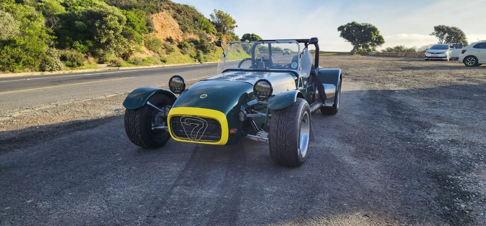
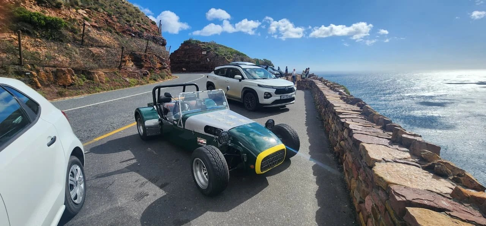
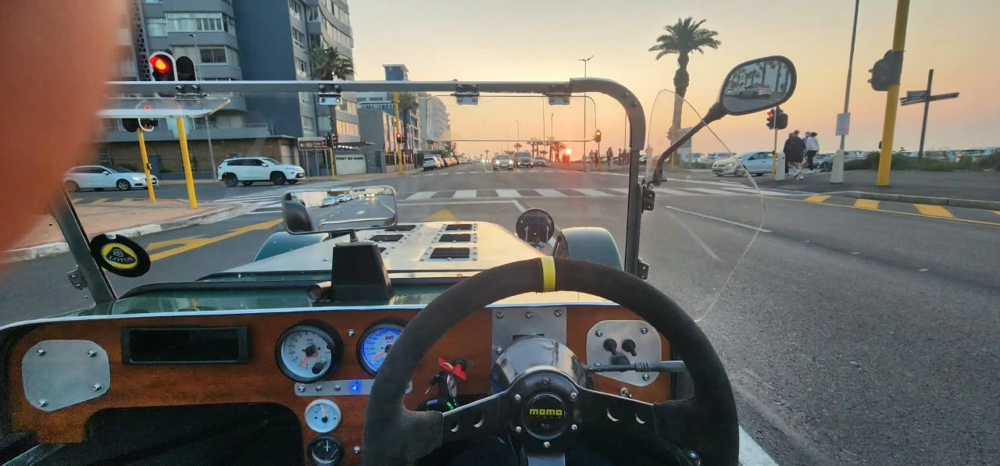
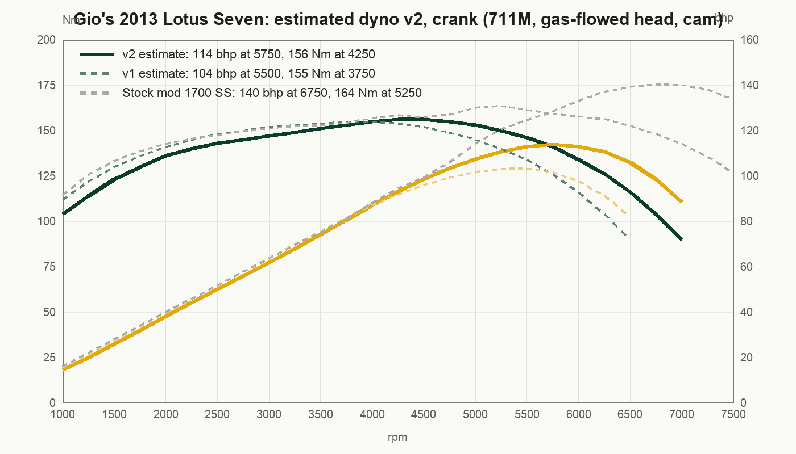
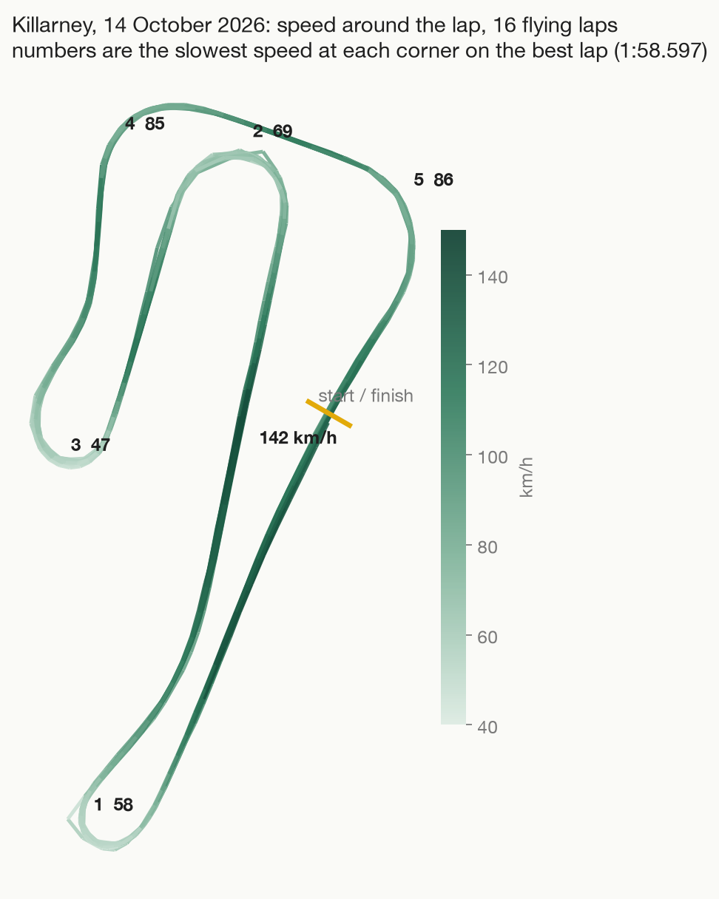
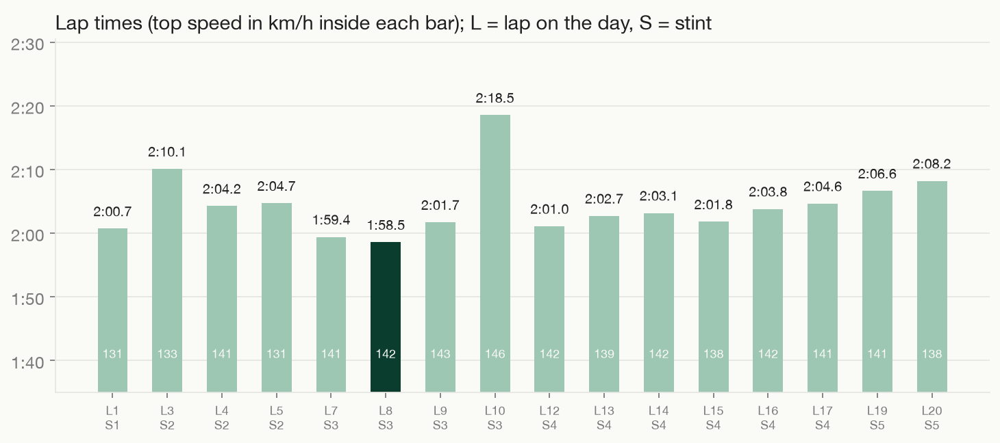

# Gio's 2013 Lotus Seven



A 2013 Birkin S3 Lotus Seven replica, British Racing Green with a yellow nose: Ford Kent crossflow, 711M block bored from 1600 to
1700, gas-flowed head, performance cam, low compression pistons, twin side-draught carbs, wrapped manifolds, 4-speed, live axle, right hand drive,
plated G-SEVEN in the sim. This repo is its twin for Assetto Corsa, built as a re-tune of Ben O'Bro and
JackCY's **Caterham Super7 1700 Super Sprint RHD** mod (v1.52, physics 2.9) from RaceDepartment.

The source tree holds only what was changed or added; `build.py` assembles the full car from the original mod's 7z,
and the releases carry the built zip.

| | |
|---|---|
|  |  |

## Download

The built car is attached to the [latest release](https://github.com/gminator/gios-2013-lotus-seven/releases/latest):
download `bo_birkin_s3_1700_kent.zip` and drag it into Content Manager. It installs as its own car and leaves the
stock Caterham alone. That zip contains the base mod's model, sounds and textures by Ben O'Bro and JackCY.

## Build it yourself

```
python3 build.py ~/Downloads/bo_caterham_1700-v1.52.7z
```

Python 3 with numpy, and `bsdtar` (on macOS by default). Output: `build/bo_birkin_s3_1700_kent/` and a zip to drag into Content
Manager.

## What is different from the stock mod

| Area | Change |
|---|---|
| Gearbox | 4-speed, Ford Type E ratios 3.65 / 1.97 / 1.37 / 1.00, final 3.92, open diff |
| Engine | 711M 1700 Kent, gas-flowed head, performance cam, low compression: about 114 bhp at 5,750 rpm, 156 Nm at 4,250, 6,800 limiter |
| Mass | 650 kg with driver |
| Rear suspension | Softer springs, less travel before the bump stops (the real car bottoms out) |
| Skin | `00_british_racing_green`: BRG with an aluminium bonnet, yellow grille lip, black 7 grille, silver rims, two side vents on the exhaust side, Union Jack and G. ADONIS on the sides, G-SEVEN plates |
| Exhaust | Remodelled to his: wrapped elbow out of the side panel, long silencer in an expanded-metal guard with three bands, bare tailpipe bending down ahead of the rear wheel (`tools/exhaust_geom.py`, written into the kn5 by the build) |
| Seats and badges | The Caterham seat patch, belt label and Super 7 roundel in the mod's `tex_misc.dds` replaced with LOTUS 7 items in orange stitching |
| Suspension | Black bike-style shocks: black springs, black damper bodies, no Bilstein band (skin texture overrides) |
| Dash and trim | White-faced VDO dials, speedo in km/h (the mod's was MPH), patched into the kn5; wooden dash, flat body-colour rear deck (the canvas tonneau and its press studs removed) with a wooden luggage rack on chrome rails (`tools/rack_geom.py`), polished screen frame and black headlight housings, all as materials and meshes written into the kn5 |

## The engine, so far an estimate



Nobody has put this engine on a dyno yet. The solid curve is the v2 guess: a 711M 1700 crossflow with a gas-flowed
head and a performance cam on twin side-draughts, held back by low compression pistons, so the torque peak sits
around 4,250 rpm and power keeps building to about 5,750. It is sized against the Garmin trace from the Killarney
straight on 14 October 2026 (80 to 130 km/h in about 9 s, best lap 1:58.3, 146 km/h on a 140 limit): the sim does
that in 6.7 s if you use 3rd and 4th and 9.9 s in 4th alone, so it is at the top of what the trace allows. The dashed
lines are the first guess (105 bhp, no cam) and the mod's 140 bhp Super Sprint. The real car gets dyno'd over the coming months; each run goes into `dyno/` and
the curve, limiter and gearing get updated from it. What would also tighten the physics: the real gearbox and diff
ratios, the tyre size, and the compression ratio.

## Track days

- [Killarney, 14 October 2026](trackday/2026-10-14/): first track day, 16 flying laps, best 1:58.6, 146 km/h. Speed heat map, racing lines, lap times and the best-lap trace from the Garmin.





## Layout

- `overlay/data/`: the 7 physics files that changed (engine, power curve, drivetrain, car, suspension, setup, AI)
- `overlay/ui/ui_car.json`: name, description, specs and curves
- `overlay/skins/00_british_racing_green/`: the livery
- `overlay/extension/`: wood and flat-normal textures plus the CSP section appended to the mod's `ext_config.ini`
- `overlay/kn5_textures/`: the redrawn dial atlas, exhaust, seat and rack textures, patched into the model by the build
- `dyno/`: engine curves, estimated now, measured later
- `photos/`: the real car
- `tools/`: kn5 parser and rewriter (textures, materials, meshes), texture extract, UV mapper, `data.acd` unpacker, engine curve model, dial redraw, livery painter, exhaust and rack geometry, seat stitching, Blender check renders, track-day charts.
  Those that draw or convert textures need `pip install pillow numpy`; the build itself does not.

## kn5 conventions learned the hard way

- Texture coordinates: the game reads `image_y = 1 + v` (v is stored negative), so row 0 of a texture needs `v = row - 1`.
- Winding: triangles are counter-clockwise about the outward normal; the game culls back faces, so the wrong way round looks see-through.
- Axes in the model: +x is the car's left, +y up, +z forward; node matrices are row-vector (`P = [p, 1] @ M`, translation in the last row).
- In the body texture the top side-panel island is the left side (exhaust), the bottom one the right side; lettering on the top island is laid out rotated 180 degrees.
- Blender's OBJ import counts v from the bottom and its camera is right-handed, so a Blender check render is the game's view flipped; use the web viewer (`tools/kn5_to_obj_full.py` + `tools/blender_glb.py`) instead.

## Credits

Model, textures, sound: Ben O'Bro. Physics research: JackCY (Jaroslav Černý). Thank you both; please support them on
RaceDepartment. The re-tune, livery and dash are Giovann Adonis's, for his own car.
