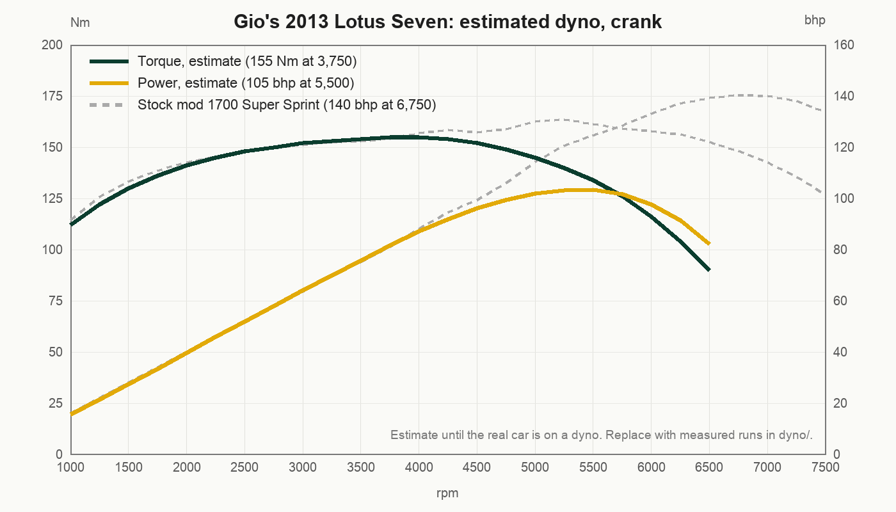

# Gio's 2013 Lotus Seven


A 2013 Birkin S3 Lotus Seven replica, British Racing Green with a yellow nose: Ford Kent crossflow 1600 bored to
1700, low compression pistons, twin side-draught carbs, wrapped manifolds, 4-speed, live axle, right hand drive,
registered CAA 692 564 in Cape Town. This repo is its twin for Assetto Corsa, built as a re-tune of Ben O'Bro and
JackCY's **Caterham Super7 1700 Super Sprint RHD** mod (v1.52, physics 2.9) from RaceDepartment.

Only what was changed or added lives here. The original mod's model, sounds and textures are not redistributed,
as its authors ask; `build.py` assembles the full car from their 7z.

| | |
|---|---|
|  |  |

## Build and install

```
python3 build.py ~/Downloads/bo_caterham_1700-v1.52.7z
```

Python 3 and `bsdtar` (on macOS by default). Output: `build/bo_birkin_s3_1700_kent/` and a zip to drag into Content
Manager. It installs as its own car and leaves the stock Caterham alone.

## What is different from the stock mod

| Area | Change |
|---|---|
| Gearbox | 4-speed, Ford Type E ratios 3.65 / 1.97 / 1.37 / 1.00, final 3.92, open diff |
| Engine | Low compression 1700 Kent: about 105 bhp at 5,500 rpm, 155 Nm at 3,750, 6,500 limiter |
| Mass | 650 kg with driver |
| Rear suspension | Softer springs, less travel before the bump stops (the real car bottoms out) |
| Skin | `00_british_racing_green`: bare aluminium body, BRG wings and tub, yellow nose, black 7 grille, CAA 692 564 plates |
| Dash | White-faced VDO dials, speedo in km/h (the mod's was MPH), patched into the kn5; wooden dash via CSP `extension/ext_config.ini` |

## The engine, so far an estimate



Nobody has put this engine on a dyno yet. The curve above is a guess for a low compression 1700 crossflow on
twin 40s, sized so the sim car does 80 to 130 km/h in 8 to 10 seconds, which is what the Garmin trace showed on the
Killarney straight on 14 October 2026 (best lap 1:58.3, 146 km/h on a 140 limit). The grey dashed line is the mod's
140 bhp Super Sprint for comparison. The real car gets dyno'd over the coming months; each run goes into `dyno/` and
the curve, limiter and gearing get updated from it. What would also tighten the physics: the real gearbox and diff
ratios, the tyre size, and the compression ratio.

## Layout

- `overlay/data/`: the 7 physics files that changed (engine, power curve, drivetrain, car, suspension, setup, AI)
- `overlay/ui/ui_car.json`: name, description, specs and curves
- `overlay/skins/00_british_racing_green/`: the livery
- `overlay/extension/`: wood and flat-normal textures plus the CSP section appended to the mod's `ext_config.ini`
- `overlay/kn5_textures/dashboard.dds`: the redrawn dial atlas, patched into the model by the build
- `dyno/`: engine curves, estimated now, measured later
- `photos/`: the real car
- `tools/`: kn5 parser, texture extract and patch, UV mapper, `data.acd` unpacker, engine curve model, dial redraw.
  Those that draw or convert textures need `pip install pillow numpy`; the build itself does not.

## Credits

Model, textures, sound: Ben O'Bro. Physics research: JackCY (Jaroslav Černý). Thank you both; please support them on
RaceDepartment. The re-tune, livery and dash are Giovann Adonis's, for his own car.
