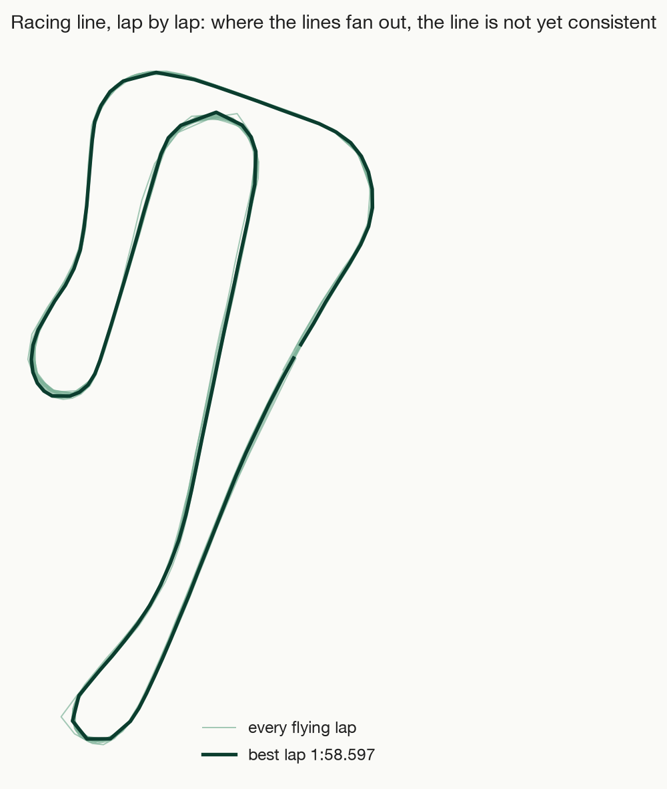
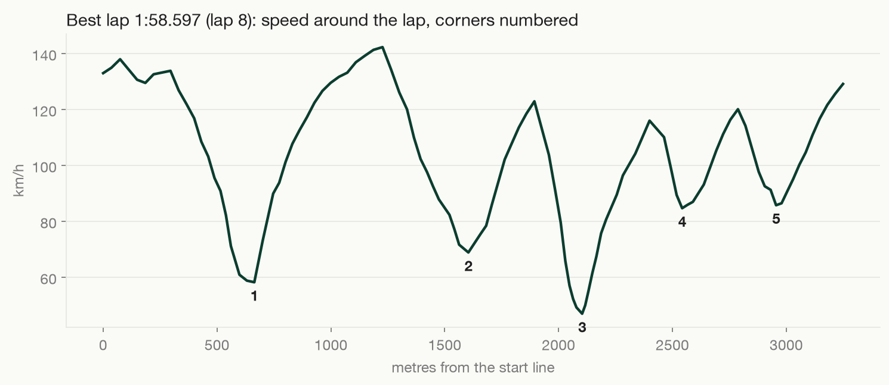

# Killarney, 14 October 2026: first track day in the Seven

Garmin Fenix 7X, 1 Hz GPS. Laps are cut at a line across the main straight, so the times are to about 0.3 s.
16 flying laps in 5 stints; the first 2 laps were with an instructor. Best lap **1:58.6**, top speed **146 km/h**.

## Laps

| Lap | Stint | Time | Top speed |
|---|---|---|---|
| 1 | 1 | 2:00.722 | 131 km/h |
| 3 | 2 | 2:10.105 | 133 km/h |
| 4 | 2 | 2:04.268 | 141 km/h |
| 5 | 2 | 2:04.712 | 131 km/h |
| 7 | 3 | 1:59.419 | 141 km/h |
| 8 | 3 | **1:58.597** | 142 km/h |
| 9 | 3 | 2:01.724 | 143 km/h |
| 10 | 3 | 2:18.549 | 146 km/h |
| 12 | 4 | 2:01.099 | 142 km/h |
| 13 | 4 | 2:02.716 | 139 km/h |
| 14 | 4 | 2:03.176 | 142 km/h |
| 15 | 4 | 2:01.806 | 138 km/h |
| 16 | 4 | 2:03.822 | 142 km/h |
| 17 | 4 | 2:04.657 | 141 km/h |
| 19 | 5 | 2:06.652 | 141 km/h |
| 20 | 5 | 2:08.216 | 138 km/h |

Files: `garmin-1hz.csv` (the raw trace: time, position, speed, altitude), `laps.csv`.
Regenerate with `python3 tools/trackday.py trackday/2026-10-14/garmin-1hz.csv trackday/2026-10-14`.
